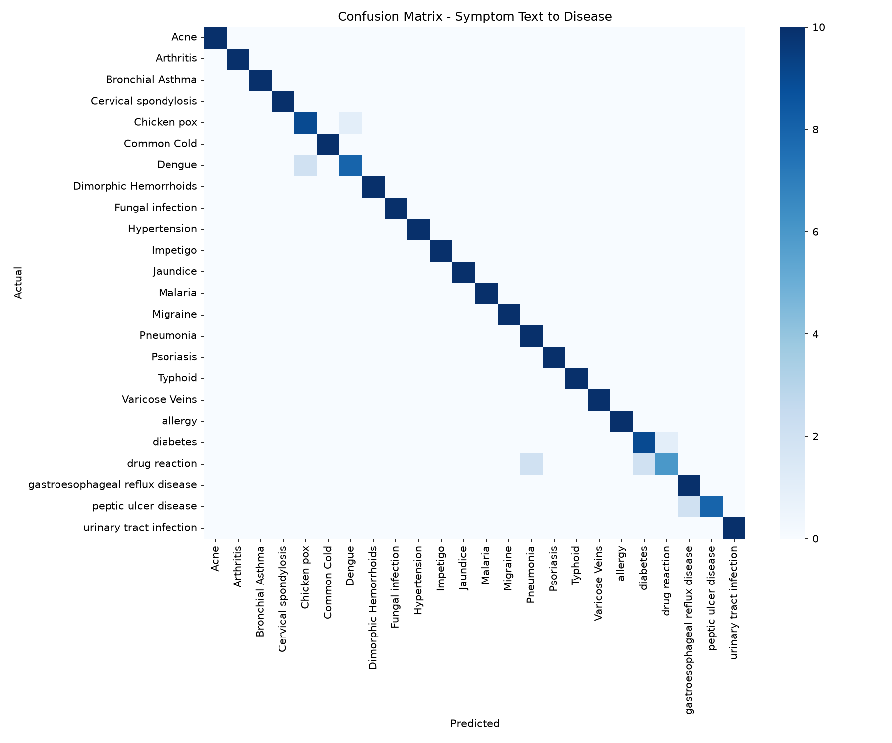

# Disease Symptom Classification: A Comparative Study of NLP and Classical ML

This case study compares two different approaches to classifying diseases from symptom data:
1. **Natural Language Processing (NLP)**: TF-IDF + Logistic Regression on free-text descriptions (Dataset: `Symptom2Disease`).
2. **Classical Machine Learning (ML)**: Random Forest Classifier on structured, binary symptom flags (Dataset: `diseases-and-symptoms-dataset`).

---

## 📊 Performance Summary

| Model / Approach | Dataset Size | Number of Unique Diseases | Accuracy | Macro Recall | Macro F1-Score |
| :--- | :--- | :--- | :--- | :--- | :--- |
| **NLP (TF-IDF + Logistic Regression)** | 1,200 rows | 24 | **96.0%** | **96.0%** | **96.0%** |
| **ML (Random Forest)** | 19,756 rows (sampled) | 673 (in sample) | **81.6%** | **76.6%** | **75.5%** |

---

## 🔍 Model 1: NLP Symptom Classifier

- **Algorithm**: TF-IDF Vectorizer (1-2 n-grams, max 3,000 features) + Logistic Regression.
- **Task**: Classifying free-text descriptions into 24 distinct disease categories.
- **Evaluation Matrix (Confusion Matrix)**:

### Live Example Prediction
- **Input Text**: `"I have a runny nose, sore throat and mild fever since yesterday"`
- **Predicted Disease**: `allergy` (Confidence: `0.15`)
- **Key Observation**: While the predicted category is reasonable, the model's confidence is low. This highlights the challenge of predicting diseases from short, ambiguous text descriptions, which may match multiple diseases' indicators.

---

## 🌲 Model 2: Structured ML Classifier

- **Algorithm**: Random Forest Classifier (100 estimators, no max depth limit).
- **Task**: Mapping 377 binary symptom flags to 673 unique diseases.
- **Top 15 Most Predictive Symptoms**:
  1. `headache` (1.88%)
  2. `vomiting` (1.67%)
  3. `sharp abdominal pain` (1.59%)
  4. `cough` (1.41%)
  5. `sharp chest pain` (1.40%)
  6. `nausea` (1.30%)
  7. `back pain` (1.29%)
  8. `fever` (1.26%)
  9. `dizziness` (1.24%)
  10. `shortness of breath` (1.22%)
  11. `leg pain` (0.91%)
  12. `sore throat` (0.87%)
  13. `depressive or psychotic symptoms` (0.84%)
  14. `weakness` (0.84%)
  15. `lower abdominal pain` (0.83%)

---

## 💬 Interview Discussion: Which Model Performed Better and Why?

Although the **NLP model** scored higher on standard metrics (96.0% vs. 81.6% accuracy), **the comparison is not apples-to-apples** and offers a rich point of discussion for machine learning interviews:

### 1. Class Cardinality & Complexity
The NLP model classifies descriptions into **24 diseases**, whereas the ML model maps binary flags to **673 unique diseases**. Randomly guessing on the ML task has a probability of $\approx 0.15\%$, while randomly guessing on the NLP task has a probability of $\approx 4.17\%$. A macro recall of $76.6\%$ over $673$ target classes is an exceptionally strong result, demonstrating that structured symptom flags contain highly distinct medical indicators.

### 2. Sparsity and Sample Distribution
- **NLP Dataset**: Evenly distributed ($50$ rows per disease), making it easy to learn balanced boundaries.
- **ML Dataset**: Extremely sparse. Many of the $673$ diseases have very few representations in the $20,000$ row sample. This lead to `UndefinedMetricWarning` warnings, as certain classes present in the training fold were absent in the test fold, dragging down the Macro Recall score.

### 3. Feature Information Density
- **Structured Data**: The binary symptom flags cleanly capture the presence/absence of $377$ symptoms. The random forest doesn't have to deal with synonyms, misspelling, negation (e.g., "no fever"), or grammatical noise.
- **Unstructured Data**: The free-text format contains rich clinical narratives, but requires clean preprocessing (lemmatization, stopword removal) to extract signals. Swapping TF-IDF + Logistic Regression for a pretrained transformer (such as `Bio_ClinicalBERT`) would capture semantic meaning (like negation and context) more robustly.

---

## ⚕️ Responsible Framing (For Portfolio Write-ups)
> [!IMPORTANT]
> Both models are **decision-support / triage exercises** for educational purposes, not validated clinical tools.
> - **Real-World Limitations**: Self-reported symptom descriptions are highly subjective and differ significantly from professional clinical notes.
> - **Deployment**: Real clinical tools require regulatory verification (e.g., FDA clearance) and validation on large, diverse datasets.
