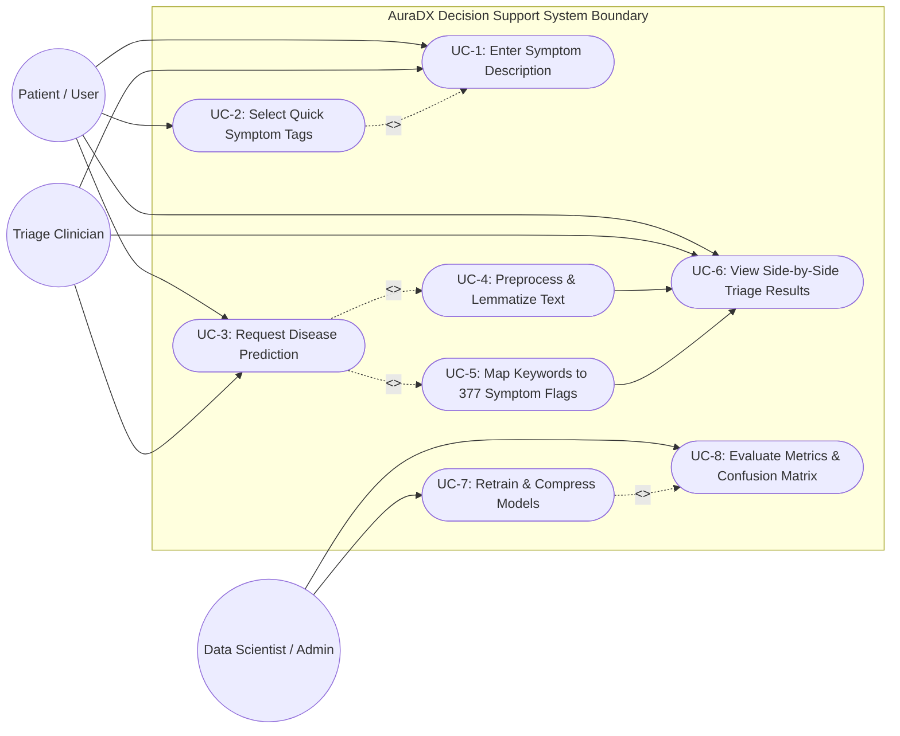
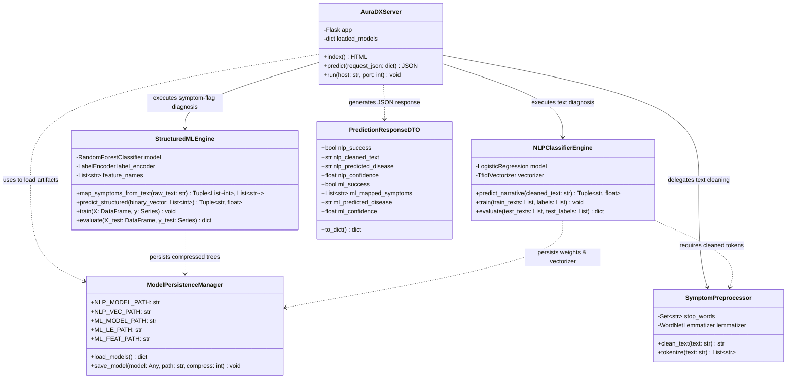
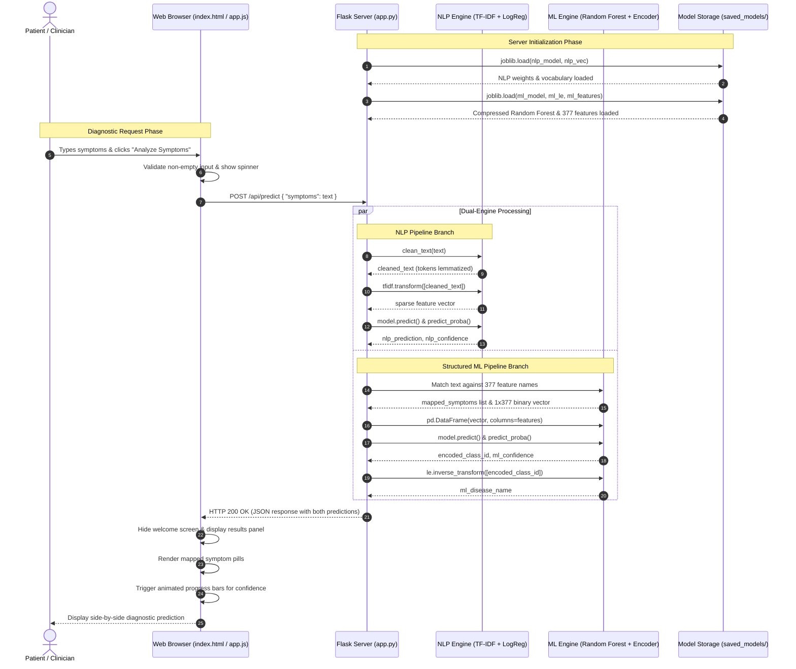
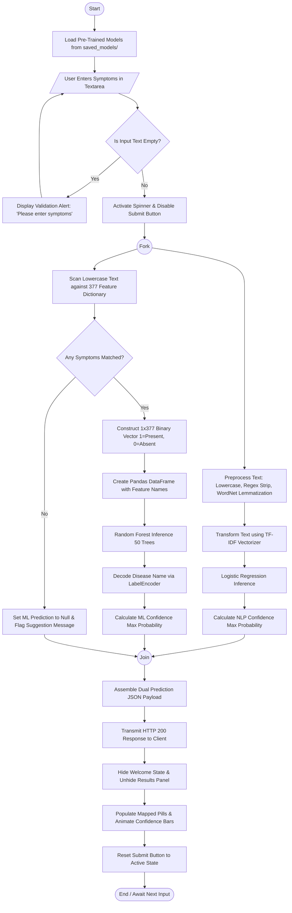

# Project Model Submission: AuraDX
### Clinical Decision Support & Dual-Engine Symptom Classifier
**Department of Data Science — Nowrosjee Wadia College, Pune**  
*(Affiliated to Savitribai Phule Pune University - SPPU)*

---

## 1. Project Understanding

### 1.1 Project Purpose & Real-World Motivation
**AuraDX** is an AI-assisted Clinical Decision Support System (CDSS) developed to address diagnostic bottlenecks in outpatient intake and patient triage. In clinical workflows, patient-reported symptoms typically arrive in two distinct formats:
1. **Unstructured natural language narratives** (e.g., conversational descriptions of discomfort, self-reported illness histories).
2. **Structured binary symptom checklists** (e.g., formalized intake forms with yes/no presence flags).

Existing symptom checkers typically force patients into a single paradigm—either a basic keyword search or a rigid checklist—often failing when narratives are noisy or when disease targets exhibit high cardinality. AuraDX bridges this gap by deploying **two complementary machine learning engines side-by-side**:
* **Engine 1 (Conversational NLP)**: Uses NLTK preprocessing (cleaning, stopword removal, WordNet lemmatization) coupled with a **TF-IDF Vectorizer** (unigrams + bigrams, 3,000 features) and a multi-class **Logistic Regression** model trained on the `Symptom2Disease` dataset (1,200 rows, 24 disease classes) to evaluate free-form text.
* **Engine 2 (Structured Clinical ML)**: Uses a memory-optimized **Random Forest Classifier** (50 decision trees, Gini criterion) trained on the high-dimensional `disease_symptoms` dataset (19,756 sampled rows across 377 binary symptom features) to predict across **673 unique diseases**.

Both models are served through a lightweight, asynchronous **Flask REST API** (`src/app.py`) connected to a responsive, glassmorphic dark-mode web dashboard (`templates/index.html`, `static/style.css`, `static/app.js`) that renders side-by-side comparative diagnoses, mapped symptom tags, and animated confidence meters in real time.

### 1.2 Core Architectural & Operational Workflow
1. **Model Training & Persistence (`src/train_all.py`)**:
   * Reads raw benchmark datasets from `data/`.
   * Cleans text narratives and samples the 190 MB structured dataset using memory-safe chunking (`chunksize=25000`).
   * Fits the NLP and ML models, evaluates classification metrics (Accuracy, Macro Recall, Macro F1), and saves confusion matrices.
   * Compresses and serializes model binaries to `saved_models/` using Joblib gzip compression (`compress=3`), reducing the ML model size from 6.6 GB to 41.4 MB.
2. **Inference Pipeline (`src/predict.py` & `src/app.py`)**:
   * Pre-loads the pre-trained `.joblib` artifacts into server memory once during cold boot.
   * Accepts user symptom inputs via CLI arguments, interactive CLI loop, or HTTP `POST /api/predict`.
   * **NLP Pathway**: Cleans input text $\rightarrow$ transforms via TF-IDF $\rightarrow$ predicts disease + probability.
   * **ML Pathway**: Scans input text against the 377 symptom vocabulary $\rightarrow$ generates a 1×377 binary vector $\rightarrow$ predicts disease + probability via Random Forest $\rightarrow$ inverse-transforms label via `LabelEncoder`.
   * **Presentation**: Asynchronously returns a structured JSON payload to the client interface for side-by-side comparison.

---

## 2. Applicable Models

In accordance with software engineering and academic data science project guidelines, system design diagrams must accurately reflect the genuine architecture of the application.

| Model / Diagram | Required? | Justification based on Existing Codebase |
| :--- | :---: | :--- |
| **Use Case Diagram** | **Yes** | **Required.** The project has clearly defined human actors (Patients/Users, Triage Staff/Clinicians, and Developers/Data Scientists) who interact with distinct system use cases such as symptom input, keyword tagging, dual-model inference, and model retraining. |
| **Class Diagram** | **Yes** | **Required.** The codebase architecture consists of modular functional domains: Text Preprocessing (`clean_text`), Model Management (`load_models`), REST Controller (`Flask app`), Inference Pipelines (NLP & Random Forest), and Presentation DTOs. |
| **Sequence Diagram** | **Yes** | **Required.** The system executes a well-defined chronological flow of synchronous/asynchronous messages across the User, Frontend UI, Flask Controller, Text Cleaning, TF-IDF Vectorizer, Random Forest Pipeline, and Disk Storage. |
| **Activity Diagram** | **Yes** | **Required.** The application contains explicit control flows, branching logic (input validation, symptom keyword detection checks), concurrent dual-engine processing, and fallback handling. |
| **Database Design / ER Diagram** | **No** | **Not required for this project.** AuraDX is a stateless machine learning inference web service. It does **NOT** use a Relational Database Management System (RDBMS like MySQL, PostgreSQL, SQLite) or a NoSQL database (like MongoDB). Data and trained model weights are stored strictly as local file system artifacts (`.csv` files and compressed `.joblib` binaries). Therefore, creating a traditional relational Entity-Relationship (ER) diagram with database tables, primary keys, and foreign keys would be technically inaccurate. A **Data & File Storage Architecture Schema** is provided instead. |

---

## 3. Use Case Diagram

### 3.1 Use Case Explanation
The Use Case diagram identifies the interactions between external actors and the AuraDX system boundary:
* **Primary Actors**:
  * **Patient / End User**: Interacts with the web application or CLI to describe physical symptoms, click quick-select symptom tags, and view potential disease predictions with confidence scores.
  * **Triage Nurse / Clinician**: Utilizes the dual predictions as an auxiliary decision-support tool to compare conversational narrative output against structured checklist predictions.
  * **Data Scientist / System Admin**: Runs the unified training pipeline (`train_all.py`), tunes hyperparameters, evaluates performance metrics (F1-score, Recall, Confusion Matrix), and maintains model binaries.
* **Key Use Cases**:
  * `UC-1: Input Symptom Description`: Enter free-form narrative text.
  * `UC-2: Select Symptom Keyword Tags`: Click suggestion pills to append verified clinical keywords (`<<extend>>`).
  * `UC-3: Request Dual Disease Diagnosis`: Trigger the `/api/predict` endpoint.
  * `UC-4: Clean & Lemmatize Text`: NLTK pipeline execution (`<<include>>` by NLP prediction).
  * `UC-5: Extract & Map Binary Symptoms`: Vocabulary matching against 377 symptom features (`<<include>>` by ML prediction).
  * `UC-6: View Side-by-Side Diagnostic Results`: View predicted diseases, animated confidence meters, and mapped symptom tags.
  * `UC-7: Train & Compress ML/NLP Models`: Execute offline training, model serialization (`.joblib`), and confusion matrix generation.

### 3.2 Use Case Diagram (Mermaid)



---

## 4. Class Diagram

### 4.1 Class Diagram Explanation
The project is implemented in Python, leveraging Flask, Scikit-Learn, NLTK, and Pandas. While implemented with functional module scripts (`app.py`, `predict.py`, `train_all.py`), the underlying architecture maps cleanly to a cohesive academic Object-Oriented Software Design:
1. **`SymptomPreprocessor`**: Handles natural language text sanitation, stopword removal, and WordNet lemmatization.
2. **`NLPClassifierEngine`**: Wraps the Scikit-Learn `TfidfVectorizer` and `LogisticRegression` classifier for free-text narrative processing.
3. **`StructuredMLEngine`**: Manages the 377-feature dictionary, keyword substring matching, binary vector construction, and inference using the compressed `RandomForestClassifier` and `LabelEncoder`.
4. **`ModelPersistenceManager`**: Interfaces with `joblib` for disk-based serialization with gzip compression (`compress=3`).
5. **`AuraDXServer`**: The Flask web controller exposing routes (`/`, `/api/predict`), dispatching prediction tasks, and assembling the HTTP JSON response.
6. **`PredictionResponseDTO`**: The standardized transfer object holding side-by-side diagnostic results, confidence percentages, cleaned text, and mapped symptom tags.

### 4.2 Class Diagram (Mermaid)



---

## 5. Sequence Diagram

### 5.1 Sequence Diagram Explanation
This diagram traces the exact end-to-end execution of a diagnostic inquiry when a user submits symptom descriptions through the web application:
1. **User Interaction**: The user enters a symptom narrative (e.g., *"I have a severe headache, nausea, and vomiting"*) and clicks **"Analyze Symptoms"**.
2. **Client-Side Event (`app.js`)**: Validates that the input is non-empty, activates the loading spinner, disables the button, and dispatches an asynchronous HTTP `POST` request to `/api/predict` with JSON payload `{"symptoms": "..."}`.
3. **Server Dispatch (`app.py`)**: The Flask controller receives the request and coordinates two parallel processing branches:
   * **Branch A (NLP Pipeline)**:
     * Calls `clean_text()` $\rightarrow$ strips punctuation, removes stopwords, applies WordNet lemmatization (`"headache nausea vomiting"`).
     * Passes cleaned text to `TfidfVectorizer.transform()` to compute n-gram feature weights.
     * Evaluates weights using `LogisticRegression.predict()` and `predict_proba()` to obtain the disease label and confidence.
   * **Branch B (Structured ML Pipeline)**:
     * Scans lowercased raw text against the 377 symptom vocabulary.
     * Identifies matches (`["headache", "nausea", "vomiting"]`) and builds a 1×377 binary indicator vector.
     * Constructs a single-row Pandas DataFrame with preserved feature names.
     * Invokes `RandomForestClassifier.predict()` and `predict_proba()`.
     * Decodes the integer class index back to the medical name using `LabelEncoder.inverse_transform()`.
4. **Response Aggregation**: Flask packages both results into a unified JSON object and returns HTTP 200.
5. **UI Rendering**: `app.js` receives the JSON, hides the empty welcome state, renders the mapped symptom tag pills, and triggers the animated progress bars from 0% to the target confidence percentages.

### 5.2 Sequence Diagram (Mermaid)



---

## 6. Activity Diagram

### 6.1 Activity Diagram Explanation
The Activity diagram models the operational logic and decision forks from application launch through inference:
* **Input Validation Decision**: Checks whether the user submitted text or clicked "Analyze" with an empty box.
* **Parallel Processing Fork**: Simultaneously executes the free-text NLP categorization and the structured keyword mapper.
* **ML Keyword Match Decision**: Evaluates whether any of the 377 clinical keywords appeared in the patient's narrative:
  * **Yes**: Builds the binary vector and queries the Random Forest.
  * **No**: Sets prediction to `None` and displays a guidance message advising the user to enter clinical terms like *"fever"* or *"cough"*.
* **Display Join**: Joins both pipelines to generate the side-by-side comparative UI.

### 6.2 Activity Diagram (Mermaid)



---

## 7. Database Design & Storage Architecture

### 7.1 Database Applicability Statement
> **Official Statement on Database Design**:  
> **A traditional Relational Database (RDBMS) / Entity-Relationship (ER) Diagram is NOT required for this project.**  
> 
> **Technical Justification**:  
> AuraDX is designed as a **stateless model-serving and real-time inference web application**. It does not perform transaction processing (OLTP), user authentication, or persistent patient record storage in a database engine like MySQL, PostgreSQL, or SQLite.  
> 
> Instead, the application utilizes a **File-Based Machine Learning Storage Architecture**:
> 1. **Tabular Training Datasets**: Stored as flat CSV files in the `data/` directory.
> 2. **Model Artifacts & Vocabulary Dictionaries**: Serialized and loaded directly from compressed `.joblib` binary files in `saved_models/`.

### 7.2 File Storage & Data Architecture Schema
To provide academic rigor for evaluators, the schema below details the structure of the input datasets and serialized model files used in the project:

```
project_wadia/
├── data/
│   ├── Symptom2Disease.csv           --> Dataset 1 (NLP Source)
│   └── disease_symptoms.csv          --> Dataset 2 (ML Source)
└── saved_models/
    ├── nlp_disease_model.joblib      --> Serialized LogisticRegression Weights
    ├── nlp_vectorizer.joblib         --> Serialized TfidfVectorizer Vocabulary
    ├── ml_disease_model.joblib       --> Serialized Compressed RandomForest (gzip level 3)
    ├── ml_label_encoder.joblib       --> Serialized LabelEncoder Mapping
    ├── ml_features.joblib            --> Serialized List of 377 Feature Strings
    └── confusion_matrix_nlp.png      --> Evaluation Confusion Matrix Heatmap
```

#### Detailed Data Dictionary & Schema Specifications:

1. **`Symptom2Disease.csv` (NLP Training Dataset)**:
   * **Total Records**: 1,200 rows (balanced, 50 samples per class).
   * **Attributes**:
     * `Unnamed: 0` *(Integer)*: Sample index.
     * `label` *(String, Categorical Target)*: Name of the medical condition (24 unique classes: Acne, Arthritis, Bronchial Asthma, Cervical spondylosis, Chicken pox, Common Cold, Dengue, Diabetes, Fungal infection, Hypertension, Malaria, Migraine, Pneumonia, Psoriasis, Typhoid, etc.).
     * `text` *(String, Free-Form Text Feature)*: Natural language patient symptom descriptions.

2. **`disease_symptoms.csv` (Structured ML Training Dataset)**:
   * **Total Records**: 246,947 raw rows (sampled down to 19,756 records via chunked loading to prevent out-of-memory errors).
   * **Attributes (378 Total Columns)**:
     * `diseases` *(String, Categorical Target)*: Target disease name (673 unique disease classes in sample).
     * `anxiety and nervousness` through `neck weakness` *(377 Numerical/Binary Columns, Values: `0` or `1`)*: One-hot encoded symptom presence flags (e.g., `headache`, `fever`, `vomiting`, `sharp chest pain`, `cough`, `shortness of breath`, etc.).

3. **Serialized Binary Models (`saved_models/`)**:
   * **`nlp_disease_model.joblib`** (577 KB): Scikit-Learn `LogisticRegression(max_iter=1000)` multi-class weight matrix.
   * **`nlp_vectorizer.joblib`** (112 KB): Scikit-Learn `TfidfVectorizer` vocabulary mapping tokens to n-gram index weights.
   * **`ml_disease_model.joblib`** (41.4 MB): Compressed ensemble of 50 Decision Trees (`RandomForestClassifier`, serialized with `compress=3`).
   * **`ml_label_encoder.joblib`** (14 KB): Scikit-Learn `LabelEncoder` mapping integer predictions `[0...672]` back to disease strings.
   * **`ml_features.joblib`** (7.5 KB): Python list of 377 strings defining the exact column sequence for DataFrame inference.

---

## 8. Final Submission Checklist

The following artifacts have been created and verified in your workspace. You can submit these directly to your faculty:

| Item # | Submission Requirement | File / Artifact Path | Status |
| :---: | :--- | :--- | :---: |
| **1** | **Project Models Document** | [`project_models_submission.md`](file:///c:/Users/LENOVO/Downloads/project_wadia/project_models_submission.md) | **Complete** |
| **2** | **Use Case Diagram** | Section 3 of `project_models_submission.md` (Mermaid code & narrative) | **Verified** |
| **3** | **Class Diagram** | Section 4 of `project_models_submission.md` (Mermaid code & narrative) | **Verified** |
| **4** | **Sequence Diagram** | Section 5 of `project_models_submission.md` (Mermaid code & narrative) | **Verified** |
| **5** | **Activity Diagram** | Section 6 of `project_models_submission.md` (Mermaid code & narrative) | **Verified** |
| **6** | **Database / Storage Schema** | Section 7 of `project_models_submission.md` (Data architecture & justification) | **Verified** |
| **7** | **2-Page Project Synopsis (Markdown)** | [`synopsis.md`](file:///c:/Users/LENOVO/Downloads/project_wadia/synopsis.md) | **Complete** |
| **8** | **2-Page Project Synopsis (Print-Ready)** | [`synopsis_print.html`](file:///c:/Users/LENOVO/Downloads/project_wadia/synopsis_print.html) *(Opens in browser $\rightarrow$ Save as PDF)* | **Complete** |
| **9** | **Source Code Repository** | [`src/app.py`](file:///c:/Users/LENOVO/Downloads/project_wadia/src/app.py), [`src/train_all.py`](file:///c:/Users/LENOVO/Downloads/project_wadia/src/train_all.py), [`src/predict.py`](file:///c:/Users/LENOVO/Downloads/project_wadia/src/predict.py) | **Tested & Working** |
| **10**| **Trained Binary Models** | [`saved_models/`](file:///c:/Users/LENOVO/Downloads/project_wadia/saved_models) (41 MB compressed artifacts) | **Tested & Working** |
